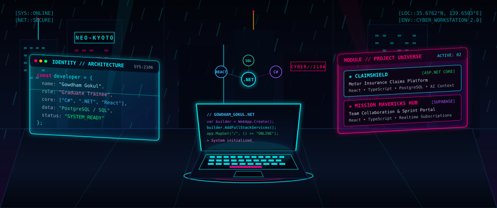

<!--
╔══════════════════════════════════════════════════════════════════════╗
║               GOWDHAM's WORKSTATION // GOWDHAM GOKUL                 ║
║         GitHub Profile Ecosystem • Theme: Cyberpunk Workstation       ║
║         Repository: gowdham2106/gowdham2106                          ║
╚══════════════════════════════════════════════════════════════════════╝
-->

<div align="center">

<!-- ◈ MAIN CYBERPUNK HERO BANNER ◈ -->


<!-- ◈ TYPING SUBTITLE SEQUENCE ◈ -->
<a href="https://github.com/gowdham2106">
  
</a>

<br/>

<!-- ◈ TELEMETRY STATUS BADGES ◈ -->
<a href="https://github.com/gowdham2106">
  
</a>
<a href="https://github.com/gowdham2106">
  
</a>
<a href="https://github.com/gowdham2106">
  
</a>

<br/><br/>

</div>

---

## ◈ 01 — WORKSTATION

<div align="center">

<!-- Centered Prominent Neo-Kyoto Cyberpunk Workstation Visual -->
<p align="center">
  
</p>

</div>

```text
╔══════════════════════════════════════════════════════════════════════════════╗
║                   GOWDHAM's WORKSTATION // ROOT ENVIRONMENT                    ║
╠══════════════════════════════════════════════════════════════════════════════╣
║                                                                              ║
║  OPERATOR         : GOWDHAM G                                          ║
║  DESIGNATION      : Graduate Trainee | Full-Stack Developer                  ║
║  CLASS            : Software Engineer                         ║
║  WORKSPACE REPO   : https://github.com/gowdham2106/gowdham2106               ║
║  CORE STACK       : C# • ASP.NET Core • React • TypeScript • PostgreSQL • AI ║
║  MISSION DIRECTIVE: Transform complex ideas into resilient, scalable software║
║                                                                              ║
╚══════════════════════════════════════════════════════════════════════════════╝
```

> **Terminal Log:** Welcome to the **Gowdham's Workstation**. This profile is the central command center of my developer universe. Here, full-stack architecture meets modern reactive web engineering, powered by enterprise C#/.NET Core on the server side and immersive, type-safe React and TypeScript on the client side.

<div align="center">

<a href="https://github.com/gowdham2106/gowdham2106">
  
</a>

</div>

<br/>

| Workstation Node | Implementation Focus | Runtime Telemetry |
|:---|:---|:---:|
| **Server Architecture** | ASP.NET Core Web APIs, Clean Architecture, Dependency Injection, EF Core | `ACTIVE` |
| **Client Interface** | Modern React 18, Strict TypeScript, Tailwind CSS, 3D WebGL / Canvas | `OPTIMIZED` |
| **Data Persistence** | PostgreSQL Relational Schema Modeling, Supabase RLS, SQL Indexing | `ONLINE` |
| **Intelligent Layer** | AI-assisted claim contextualization, workflow automation pipelines | `DEPLOYED` |

---

## ◈ 02 — IDENTITY MATRIX

```text
╔══════════════════════════════════════════════════════════════════════════════╗
║                         DEVELOPER IDENTITY MATRIX                            ║
╠══════════════════════════════════════════════════════════════════════════════╣
║  "Explore the unknown. Engineer the solution. Build something meaningful."   ║
╚══════════════════════════════════════════════════════════════════════════════╝
```

I am **Gowdham Gokul**, a Graduate Trainee and Aspiring Full-Stack Developer dedicated to mastering full-lifecycle software engineering. My technical journey is anchored in four engineering pillars:

### 1. C# and ASP.NET Core Development
- Architecting high-throughput, asynchronous RESTful APIs using **C#** and **ASP.NET Core**.
- Structuring decoupled backends adhering to **Clean Architecture**, repository patterns, and dependency injection.
- Utilizing **Entity Framework Core (EF Core)** for robust Object-Relational Mapping, automated migrations, and optimized query execution plans.
- Implementing secure authentication and authorization mechanisms with JWT and policy-based claims.

### 2. React and TypeScript Systems
- Crafting dynamic, component-driven Single Page Applications using **React** and modern hook paradigms.
- Enforcing end-to-end type safety through **TypeScript** (strict interfaces, utility types, and generic components) to eliminate runtime regressions.
- Composing responsive, sleek user interfaces with **Tailwind CSS** and building interactive WebGL canvas experiences with Three.js.
- Designing predictable state management structures with optimized rendering lifecycles.

### 3. PostgreSQL and Database Engineering
- Designing normalized relational schemas with strict foreign-key constraints and data integrity standards in **PostgreSQL** and **SQL**.
- Tuning query performance through indexing strategies (B-Tree, GIN) and transaction isolation management.
- Utilizing **Supabase** for real-time WebSocket database subscriptions, automated triggers, and granular Row-Level Security (RLS) policies.

### 4. AI-Assisted Application Development
- Embedding AI context pipelines into real-world business workflows to accelerate decision-making.
- Engineering intelligent categorization and context-scoring modules (as deployed in **ClaimShield** for motor insurance claims).
- Leveraging modern developer AI tooling to accelerate test generation, documentation, and architectural modeling.

---

## ◈ 03 — ARSENAL

<div align="center">

<!-- Skill Icons Matrix -->
<a href="https://skillicons.dev">
  
</a>

</div>

<br/>

### `[ LANGUAGES ]`
<p>
  
  
  
  
  
  
</p>

### `[ FRONTEND DEVELOPMENT ]`
<p>
  
  
  
  
  
  
</p>

### `[ BACKEND ENGINEERING ]`
<p>
  
  
  
  
  
</p>

### `[ DATABASE SYSTEMS ]`
<p>
  
  
  
  
</p>

### `[ TOOLS & PLATFORMS ]`
<p>
  
  
  
  
  
  
</p>

### `[ AI & DEVELOPMENT TOOLS ]`
<p>
  
  
  
  
</p>

---

## ◈ 04 — PROJECT UNIVERSE

<table>
<tr>
<td width="50%" valign="top">

<div align="center">

### 🛡️ CLAIMSHIELD
**Motor Insurance Claims Intelligence Platform**


</div>

```text
[ SYSTEM MODULE SPECIFICATIONS ]
TYPE     : Full-Stack Claims Management System
BACKEND  : ASP.NET Core (C# Web API)
FRONTEND : React + TypeScript + Tailwind CSS
DATABASE : PostgreSQL Relational DB
AI CORE  : Automated Context Scoring Module
```

**Core Capabilities:**
- **Claim Lifecycle Management**: Multi-step guided filing process capturing incident details, parties involved, and damage telemetry.
- **Instant Policy Verification**: Validates coverage limits, deductibles, and vehicle policy active dates against the database.
- **Secure Document Upload**: Handles vehicle inspection photos, official police incident reports, and repair estimates.
- **AI-Assisted Claim Context**: Prepares summarized damage context and preliminary consistency scores to expedite claims adjuster review.

<div align="center">

<br/>

<a href="https://github.com/gowdham2106/claimshield">
  
</a>

</div>

</td>
<td width="50%" valign="top">

<div align="center">

### 🚀 MISSION MAVERICKS HUB
**Team Collaboration & Agile Project Command Portal**


</div>

```text
[ SYSTEM MODULE SPECIFICATIONS ]
TYPE     : Real-Time Team Command Portal
FRONTEND : React + TypeScript + Tailwind CSS
DATABASE : Supabase (PostgreSQL + RLS)
REALTIME : WebSocket Real-Time Broadcasts
SECURITY : Granular Row-Level Security Policies
```

**Core Capabilities:**
- **Squad Command Dashboard**: Real-time overview of active squad members, ticket velocity, and sprint statuses.
- **Project Journey Roadmaps**: Visual milestone progression charting deadlines, deliverable phases, and release checkpoints.
- **Centralized Documentation**: Structured markdown technical knowledge base and engineering specifications.
- **Real-Time Collaboration**: Instant synchronized updates across distributed squad workspaces powered by Supabase.

<div align="center">

<br/>

<a href="https://github.com/gowdham2106/maverick-hub">
  
</a>

</div>

</td>
</tr>
</table>

---

## ◈ 05 — INTEL


<!-- Top Languages Card -->


<br/><br/>

<!-- Streak Stats Card -->
<a href="https://github.com/gowdham2106">
  
</a>

<br/><br/>


</div>

<br/>

<!-- Collapsible Telemetry Audit Log for Fallback Readability -->
<details>
<summary><b>[ CLICK TO EXPAND TELEMETRY AUDIT LOG ]</b></summary>
<br/>

| Telemetry Metric | Target Description | Verification Status |
|:---|:---|:---:|
| **Public Core Repositories** | ClaimShield, Mission Mavericks Hub, Clean Arch Modules | `PUBLIC // ACTIVE` |
| **Language Footprint** | C#, TypeScript, JavaScript, SQL, HTML5, CSS3 | `SYNCHRONIZED` |
| **Version Control Discipline** | Semantic commits, clean feature branching, PR workflows | `STANDARDIZED` |
| **Continuous Integration** | Automated build and verification workflows via GitHub Actions | `DEPLOYABLE` |

</details>

---

## ◈ 06 — CURRENT MISSIONS

```text
╔══════════════════════════════════════════════════════════════════════════════╗
║                     CURRENT ACTIVE LEARNING MISSIONS                         ║
╠══════════════════════════════════════════════════════════════════════════════╣
║                                                                              ║
║  [MISSION // 01]  IMPROVING .NET DEVELOPMENT                                 ║
║                   Clean Architecture, CQRS, Middleware, EF Core Query Tuning ║
║                   Progress: [██████████████████████░░] 88%                   ║
║                                                                              ║
║  [MISSION // 02]  LEARNING ADVANCED REACT AND TYPESCRIPT                     ║
║                   Generic Components, Custom Hooks, Performance Profiling    ║
║                   Progress: [███████████████████████░] 92%                   ║
║                                                                              ║
║  [MISSION // 03]  DATABASE DESIGN AND SQL                                    ║
║                   Relational Schema Normalization, PostgreSQL Index Tuning   ║
║                   Progress: [█████████████████████░░░] 84%                   ║
║                                                                              ║
║  [MISSION // 04]  AI INTEGRATION AND APPLICATION ARCHITECTURE                ║
║                   Context Processing Pipelines, RESTful Contract Design      ║
║                   Progress: [████████████████████░░░░] 80%                   ║
║                                                                              ║
║  [MISSION // 05]  GIT AND GITHUB WORKFLOWS                                   ║
║                   Branching Strategies, CI/CD with GitHub Actions            ║
║                   Progress: [████████████████████████] 95%                   ║
║                                                                              ║
║  STATUS: PROGRESS IS CONTINUOUS // UPGRADE IN PROGRESS...                    ║
║                                                                              ║
╚══════════════════════════════════════════════════════════════════════════════╝
```

---

## ◈ 07 — UPLINK

<div align="center">

<p>
  <strong>Transmission channels are active. Open for full-stack developer roles, graduate engineering opportunities, and technical collaborations.</strong>
</p>

<!-- GitHub Profile -->
<a href="https://github.com/gowdham2106" target="_blank">
  
</a>
&nbsp;
<!-- LinkedIn Profile -->
<a href="https://www.linkedin.com/in/gowdhamgokuldas/" target="_blank">
  
</a>
&nbsp;
<!-- Direct Email -->
<a href="mailto:gowdhamgokuldas@gmail.com">
  
</a>

<br/><br/>

```text
> UPLINK ESTABLISHED
> OPERATOR: GOWDHAM GOKUL // NEO-KYOTO NODE
> END OF TRANSMISSION_
```

<!-- Animated Cyber Wave Footer -->


</div>
